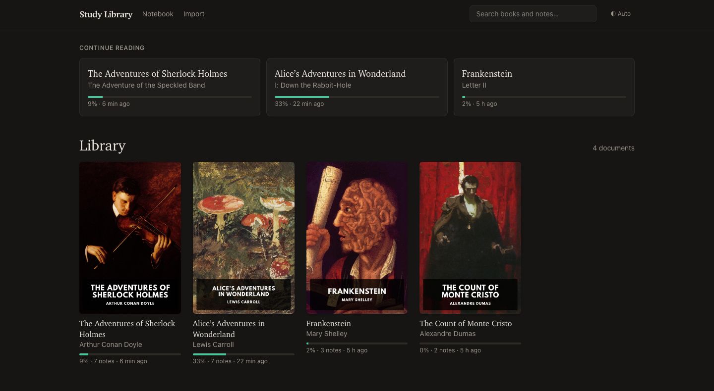

# Study Library

A simple, single-user library for **studying** books. Import your books (EPUB, MOBI, AZW3), web articles and Markdown, and read them in a clean Medium-style reader, highlight and annotate any passage, then use your AI Agent to go deeper on what you read.



## Why

I wanted a better way to learn from my books. Reading, highlighting, and asking questions to improve my understanding. This project includes skills to ask your AI to find more resources, get a technical passage explained in a way that is easier to digest, hear another take on an argument, and check that I actually remember and understand it.

This simple Study Library keeps the books as plain Markdown files and the highlights in a database, so an AI agent can read exactly the same text I read and work with it:

- **Expand the content**: ask questions about a chapter or a highlight, find videos, articles and papers to go deeper, connect an idea to other books in the library.
- **Make it easier to digest**: diagrams, worked examples, analogies and summaries next to the text.
- **Get another take**: steelman an argument, then its counterarguments and limits.
- **Verify what I know**: quizzes built from my own highlights, explain-it-back sessions, a review queue, flashcards exported to Anki.

Everything the agent produces is saved back as notes beside the chapter, so it stays with the book.

## Run it

Requirements: Node 22+, Docker, `pandoc` (`brew install pandoc`). Calibre (`ebook-convert`) only for MOBI/AZW files.

```bash
corepack enable && pnpm install
cp .env.example .env
pnpm db:up          # Postgres 18 on 127.0.0.1:5433
pnpm dev            # http://localhost:3000
```

To run it on a home server instead (app + Postgres + nightly backup):

```bash
cp .env.example .env    # set DB_PASSWORD, LIBRARY_HOST_DIR, BACKUP_HOST_DIR, APP_BIND, PUBLIC_URL
docker compose up -d --build
```

There is no login: keep it on your LAN or behind Tailscale/WireGuard. Details: `_agents/runbooks/deploy-home-server.md` and `_agents/runbooks/backup-restore.md`.

## Use it

1. **Import** a book or article: drop a file or paste a URL on http://localhost:3000/import, or run `pnpm -s lib import path/to/book.epub`.
2. **Read and highlight**: select text in the reader to highlight it (4 colors), add a note or copy a deep link. ← / → change chapter.
3. **Study with Claude Code**: open this folder in Claude Code (the server must be running) and run a skill on a chapter or a highlight:

| Skill                                  | What it does                                                           |
| -------------------------------------- | ---------------------------------------------------------------------- |
| `/study <doc> <chapter>`               | Quiz, one question at a time, using your highlights                    |
| `/review 7`                            | Mixed review of the last week's highlights and missed answers          |
| `/ask <doc> <chapter\|highlight>`      | Ask questions about the text and its diagrams                          |
| `/further-reading`                     | Find and check videos, articles, docs and papers                       |
| `/visualize`                           | Diagrams, worked examples, analogies and code                          |
| `/teach-back`                          | Explain it in your own words and get the gaps pointed out              |
| `/critique`                            | Steelman a claim, then objections, limits and what survives            |
| `/flashcards`                          | Export cards to Anki and the review queue                              |
| `/primer`, `/exercises`, `/connect`, … | Prepare for a chapter, practice, link it to your other books, and more |

The full list is in [`AGENTS.md`](AGENTS.md); other AI agents can follow the same `SKILL.md` files. From the reader, **Ask AI** copies a ready `/study … --focus <highlight>` prompt, and **Copy for AI** copies a chapter or passage as a prompt for any assistant (ChatGPT, Gemini…).

### Pages

| Where                   | What                                                                                        |
| ----------------------- | ------------------------------------------------------------------------------------------- |
| `/`                     | Library with covers, progress and "continue reading"                                        |
| `/read/<doc>`           | Table of contents, notes per chapter, re-import, export                                     |
| `/read/<doc>/<chapter>` | Reader with highlights, notes and AI notes in the margin                                    |
| `/notebook`             | All highlights and notes; filter by document, type, color, tag; free-floating notes; backup |
| `/search`               | Full-text search over every chapter and every note                                          |
| `/import`               | Upload or paste a URL; live job log and import report                                       |

## How it works

- **Content is plain Markdown on disk** (`library/<doc>/chapters/*.md`), one file per chapter, images kept.
- **Annotations live in PostgreSQL**: highlights, notes, chapter notes, bookmarks, tags, review questions and study sessions. Back them up with `pnpm -s lib export`.
- **Agents talk to the library through the `lib` CLI** (`pnpm -s lib --help`, `_agents/contracts/cli.md`), which only uses the web app's HTTP API, so it also works against a remote server (`LIB_API_URL=http://homeserver:3000`).

For contributors: `AGENTS.md` and the `_agents/` knowledge base cover the architecture, contracts, runbooks and code style (`pnpm lint`, `pnpm typecheck`, `pnpm test`).

## Content and DRM

Only import content you have the right to use; this tool does not and will not remove DRM. Public-domain editions from [Standard Ebooks](https://standardebooks.org) are a good way to try it.
